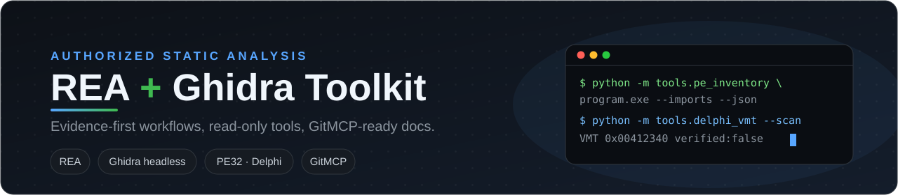

# REA + Ghidra Toolkit

<p align="center">
  
</p>

<p align="center">
  <a href="https://gitmcp.io/ethanhunt1981/rea-ghidra-toolkit">
    
  </a>
  <a href="LICENSE">
    
  </a>
  <a href="https://www.python.org/downloads/">
    
  </a>
  <a href="https://github.com/NationalSecurityAgency/ghidra">
    
  </a>
  <a href="https://github.com/morluto/rea">
    
  </a>
</p>

---

A small, dependency-light toolkit for **authorized static analysis** of native binaries with **REA** and **Ghidra**. It is intentionally built as a reusable knowledge base for agents, not as a dumping ground for a specific target.

**Think in two layers**

- This repository contains only generic methods, tools, and synthetic tests.
- Every target-specific artifact, decompilation, or private result stays in the private analysis project.

## Why this exists

You want to avoid rebuilding the same reverse-engineering workflow from scratch every time. This toolkit answers:

- How do I start a PE / Delphi analysis in a traceable way?
- How do I combine REA, Ghidra, and small local tools without treating inferences as facts?
- How do I export and document results so a later session can continue?
- Which mistakes should be avoided early instead of discovered late?

## Repository layout

```text
.
├── docs/
│   ├── workflow.md
│   ├── rea-ghidra.md
│   ├── delphi-pe32.md
│   ├── evidence.md
│   ├── troubleshooting.md
│   └── gitmcp.md
├── tools/
│   ├── pe32.py
│   ├── pe_inventory.py
│   └── delphi_vmt.py
├── ghidra/
│   └── scripts/ExportDecompilation.java
├── templates/
│   ├── analysis-log.md
│   └── handover.md
├── tests/
├── assets/
├── AGENTS.md
├── LICENSE
└── llms.txt
```

## What you get

| Area | What is inside | Good next read |
|---|---|---|
| 🧭 `docs/` | Evidence-oriented, reproducible workflows and validation rules | [`workflow.md`](docs/workflow.md) |
| 🩺 `tools/` | Read-only PE32 inventory and VMT helpers | [`tools/pe_inventory.py`](tools/pe_inventory.py) |
| 🧰 `ghidra/` | Headless export helper | [`ExportDecompilation.java`](ghidra/scripts/ExportDecompilation.java) |
| 🫙 `templates/` | Private analysis and handover templates | [`templates/analysis-log.md`](templates/analysis-log.md) |
| 🧪 `tests/` | Synthetic, dependency-light tests | [`tests/test_pe32.py`](tests/test_pe32.py) |

## Quickstart

```powershell
# From the repository root
python -m tools.pe_inventory "C:\analysis\program.exe"
python -m tools.pe_inventory "C:\analysis\program.exe" --imports --json

# Check a known VMT candidate
python -m tools.delphi_vmt "C:\analysis\program.exe" --vmt 0x00412340

# Heuristic search; always validate candidates in a disassembler
python -m tools.delphi_vmt "C:\analysis\program.exe" --scan
```

Run the synthetic test suite:

```powershell
python -m unittest discover -v
```

## GitMCP

This repository is designed to be used with <https://gitmcp.io/ethanhunt1981/rea-ghidra-toolkit>.

OpenCode / typical agent setup:

```jsonc
{
  "$schema": "https://opencode.ai/config.json",
  "mcp": {
    "servers": {
      "rea-ghidra-toolkit": {
        "type": "remote",
        "url": "https://gitmcp.io/ethanhunt1981/rea-ghidra-toolkit"
      }
    }
  }
}
```

OpenCode CLI command:

```sh
opencode mcp add rea-ghidra-toolkit --global --url https://gitmcp.io/ethanhunt1981/rea-ghidra-toolkit
opencode mcp list
```

<p align="center">
  <a href="https://gitmcp.io/ethanhunt1981/rea-ghidra-toolkit">
    
  </a>
</p>

## Core rule

> **Observation, inference, and unknown are three different things.** A plausible name, string, or VMT candidate is not yet a behavioral proof. The templates are here to keep that distinction visible across sessions.

## License

This repository is licensed under the [MIT License](LICENSE). The license covers the included methodology and tooling only. It does not cover original binaries, target-specific specifications, third-party protected material, or private analysis results.
